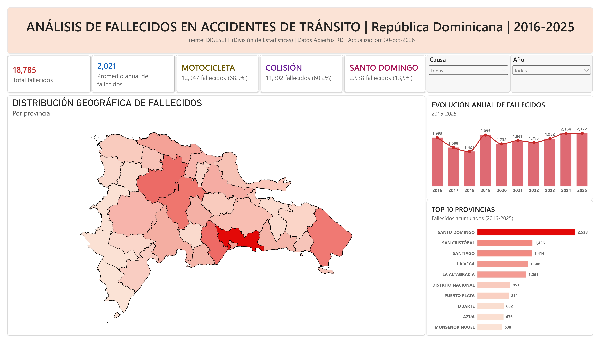
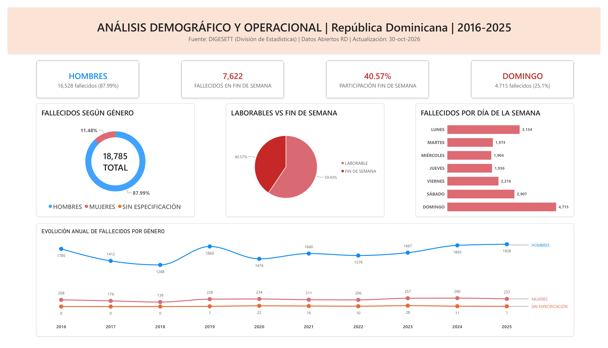

# Dashboard Power BI: Fallecidos por Accidentes de Tránsito en República Dominicana (2016-2025)

## Descripción

Proyecto de análisis y visualización de datos desarrollado en Power BI utilizando información histórica de fallecidos por accidentes de tránsito en la República Dominicana correspondiente al período 2016-2025.

El dashboard fue diseñado para identificar patrones geográficos, temporales y demográficos asociados a la siniestralidad vial mediante indicadores ejecutivos, análisis interactivo, mapas personalizados y storytelling de datos.

## Objetivos

- Analizar la distribución geográfica de los fallecidos por provincia.
- Identificar las provincias con mayor concentración de fallecidos.
- Evaluar la evolución histórica de los fallecidos durante el período analizado.
- Identificar los principales tipos de accidentes.
- Analizar los medios de transporte más involucrados.
- Examinar patrones demográficos por género.
- Identificar comportamientos asociados a los fines de semana y días de la semana.

## Herramientas Utilizadas

- Power BI
- Power Query
- DAX
- Shape Maps
- GeoJSON
- Data Storytelling
- Visualización de Datos

## Recursos Geográficos

Para la construcción del mapa provincial se utilizó un archivo GeoJSON personalizado:

- RD_PROV_corregido.json

Este archivo fue utilizado para representar geográficamente las provincias de la República Dominicana mediante Shape Maps de Power BI, permitiendo analizar la distribución espacial de los fallecidos y aplicar tooltips personalizados por provincia.

## Principales Hallazgos

- Se registraron 18,785 fallecidos durante el período 2016-2025.
- Las motocicletas estuvieron involucradas en el 68.9% de los fallecimientos.
- Las colisiones representaron el 60.2% de los casos registrados.
- Santo Domingo concentró el 13.5% de los fallecidos a nivel nacional.
- El 40.6% de los fallecidos ocurrió durante fines de semana.
- El domingo fue el día con mayor cantidad de fallecidos.
- El 88% de los fallecidos correspondió a hombres.

## Funcionalidades Implementadas

### Resumen Ejecutivo

- KPIs ejecutivos.
- Mapa geográfico por provincia.
- Ranking Top 10 de provincias.
- Evolución anual de fallecidos.
- Tooltips personalizados con:
  - Participación provincial.
  - Ranking nacional.
  - Año más fatal por provincia.
  - Total de fallecidos.

### Análisis Demográfico y Operacional

- Distribución de fallecidos por género.
- Distribución de fallecidos: laborables vs fines de semana.
- Análisis por día de la semana.
- Evolución anual de fallecidos por género.
- KPIs demográficos y operacionales.

## Capturas del Dashboard

### Página 1 – Resumen Ejecutivo



### Página 2 – Análisis Demográfico y Operacional



## Estructura del Proyecto

```text
powerbi-accidentes-rd
│
├── Dashboard.pbix
├── RD_PROV_corregido.json
├── README.md
├── resumen-ejecutivo.png
└── analisis-demografico-operacional.png
```

## Video Demostrativo

Visualización interactiva del dashboard:

👉 https://youtu.be/tL8tESCkteE

## Habilidades Demostradas

- Limpieza y transformación de datos.
- Modelado de datos.
- Creación de KPIs ejecutivos.
- Desarrollo de medidas DAX.
- Cálculo de indicadores porcentuales.
- Tooltips personalizados.
- Análisis geográfico.
- Análisis demográfico.
- Storytelling con datos.
- Diseño de dashboards ejecutivos.
- Visualización interactiva.

## Fuente de Datos

Dirección General de Seguridad de Tránsito y Transporte Terrestre (DIGESETT) y Portal Nacional de Datos Abiertos de la República Dominicana.
URL: https://datos.gob.do/dataset/estadistica-de-fallecimientos-por-accidentes-de-transito

## Autor

Fernando Núñez

Proyecto desarrollado con fines educativos y de portafolio en Power BI.
